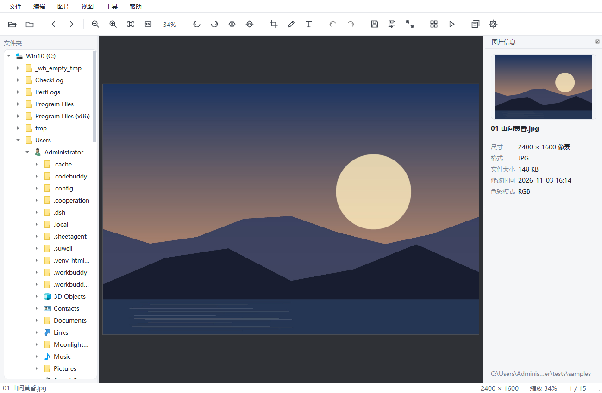
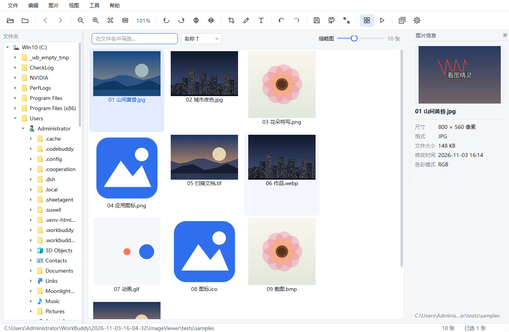
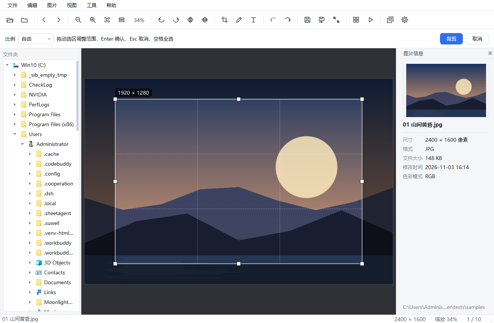
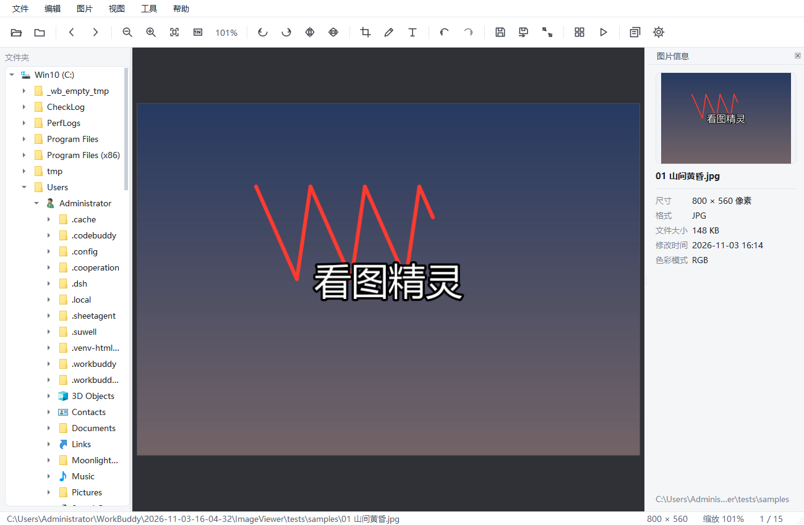
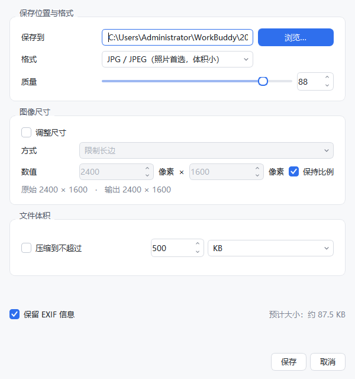
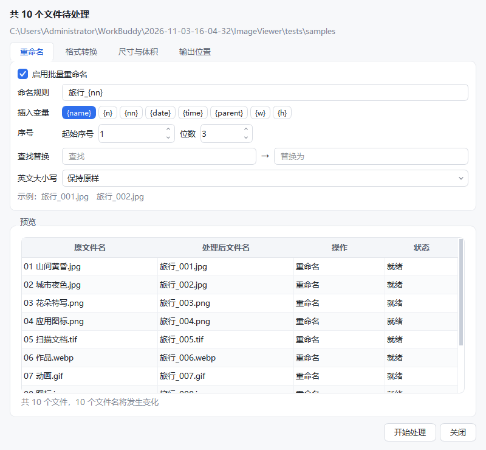
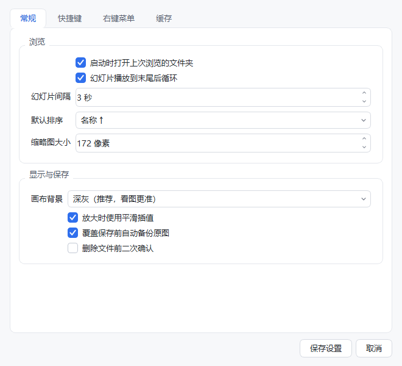
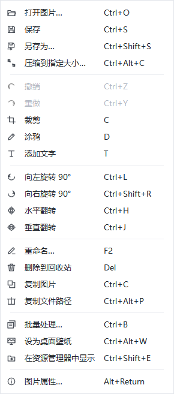
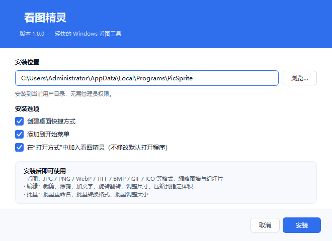

# 看图精灵 (PicSprite)

一个为 Windows 打造的轻量看图工具：打开快、能编辑、能批量、能压体积，日常看图基本不用再装第二个软件。



## 下载安装

到 [Releases](https://github.com/mew5748-alt/PicSprite/releases/latest) 下载 **`PicSprite-Setup-1.0.0.exe`**，双击按向导安装即可，无需 Python 环境。

- 单个 exe 安装包，约 94 MB，安装后占用约 217 MB
- 装到当前用户目录 `%LOCALAPPDATA%\Programs\PicSprite`，**不需要管理员权限**
- 自带卸载程序（开始菜单「卸载看图精灵」或 设置 → 应用）
- 可选把看图精灵加入图片的「打开方式」（不修改你的默认打开程序）
- 静默安装：`PicSprite-Setup-1.0.0.exe /S`

```powershell
# 校验下载的安装包（值见 Release 里的 SHA256SUMS.txt）
Get-FileHash .\PicSprite-Setup-1.0.0.exe -Algorithm SHA256
```

## 功能一览

**看图**

- 支持 BMP / JPG / JPEG / PNG / GIF / ICO / TIFF / WebP / TGA / PSD 等常见格式
- 缩放（滚轮对准光标缩放）、拖动平移、适应窗口、1:1、全屏、幻灯片播放
- 自动按 EXIF 方向摆正手机照片；GIF 与多页 TIFF 可逐帧查看
- 缩略图墙：异步加载 + 磁盘缓存，切回文件夹秒开；支持筛选与多种排序
- 左侧目录树、右侧信息面板（尺寸/格式/体积/拍摄参数）、拖拽打开、最近文件夹记忆

**编辑**

- 旋转 / 翻转：默认是**临时预览**（不动物文件），点保存才落盘；右键菜单里也可选"旋转并写入文件"直接永久生效
- 裁剪：自由比例或 1:1 / 4:3 / 16:9 / 原图比例，三分构图线 + 八向控制点 + 实时尺寸提示，Enter 确认
- 涂鸦：任意颜色、1–60px 粗细，直接画在图上
- 添加文字：字体 / 字号 / 加粗 / 倾斜 / 颜色 / 描边，放到图上后可拖动定位，Enter 确认
- 调整尺寸、撤销 / 重做（最多 15 步，按内存预算自动收敛）、放弃全部修改

**另存为 / 压缩**

- 一键转换格式：JPG / PNG / WebP / BMP / TIFF / GIF / ICO，可带质量参数
- 保存时同时可改尺寸（百分比 / 长边 / 宽 / 高 / 精确宽高）并限制文件体积
- **压缩到指定大小**：先二分搜索 JPEG/WebP 质量，仍超标再逐级缩小尺寸，右侧实时预估体积
- 覆盖前自动备份到 `.picsprite_backup`，写盘采用临时文件 + 原子替换，不怕写坏原图

**批量**

- 批量重命名：变量 `{name} {n} {nn} {date} {time} {parent} {w} {h}`、起始序号、补零、查找替换、大小写
- 批量转换格式 / 批量调整尺寸 / 批量限制体积，可组合使用
- 输出到子文件夹、指定目录或原地覆盖，执行前有完整预览表与重名检测，进度可中止

**个性化**

- 全部快捷键可在「设置 → 快捷键」里重新绑定，带冲突检测、可一键恢复默认
- 「设置 → 右键菜单」可勾选、排序、增删右键菜单项
- 可调画布背景（深灰 / 中灰 / 浅色）、缩略图尺寸、幻灯片间隔、缓存上限

## 界面

| 看图 | 缩略图墙 |
| --- | --- |
|  |  |

| 裁剪 | 涂鸦与加字 |
| --- | --- |
|  |  |

| 另存为（改格式/尺寸/体积） | 批量处理 |
| --- | --- |
|  |  |

| 设置（快捷键 / 右键菜单） | 右键菜单 |
| --- | --- |
|  |  |

| 安装向导 |
| --- |
|  |

## 运行

需要 Python 3.9+ 和两个依赖：

```bat
pip install -r requirements.txt
python main.py                 :: 打开上次的文件夹
python main.py D:\照片          :: 打开文件夹
python main.py D:\a.jpg        :: 打开单张图片
```

也可以直接双击 **`run.bat`**（用 pythonw 启动，不弹黑框）。

### 打包 exe

- 只要绿色版程序目录：双击 **`build_exe.bat`**，产物在 `dist\看图精灵\看图精灵.exe`，
  整个 `dist\看图精灵` 文件夹拷走即可在没装 Python 的电脑上运行。
- 要**安装包**：`python tools/build_release.py`，产物是 `dist\看图精灵-Setup-1.0.0.exe`
  （发布时重命名为 `PicSprite-Setup-<版本>.exe`，避免中文文件名在下载链接里出错）
  （自带解压安装引擎，安装/卸载/快捷方式/文件关联全部自实现，不依赖 Inno Setup）。

安装包支持 `/S` 静默安装、`/uninstall` 卸载。

## 快捷键

| 功能 | 快捷键 | 功能 | 快捷键 |
| --- | --- | --- | --- |
| 打开图片 | Ctrl+O | 上一张 / 下一张 | ← / → |
| 保存 / 另存为 | Ctrl+S / Ctrl+Shift+S | 放大 / 缩小 | Ctrl+= / Ctrl+- |
| 压缩到指定大小 | Ctrl+Alt+C | 适应窗口 / 100% | Ctrl+0 / Ctrl+1 |
| 向左 / 向右旋转 | Ctrl+L / Ctrl+Shift+R | 裁剪 / 涂鸦 / 文字 | C / D / T |
| 水平 / 垂直翻转 | Ctrl+H / Ctrl+J | 撤销 / 重做 | Ctrl+Z / Ctrl+Y |
| 缩略图墙 | Tab | 全屏 | F11 |
| 批量处理 | Ctrl+B | 幻灯片 | F6（Esc 退出） |
| 重命名 / 删除 | F2 / Del | 设为壁纸 | Ctrl+Alt+W |
| 设置 | Ctrl+, | 快捷键速查 | F1 |

## 目录结构

```
ImageViewer/
├─ main.py                 入口
├─ run.bat                 双击运行
├─ build_exe.bat           打包绿色版 exe
├─ installer/
│  └─ setup_main.py        安装/卸载程序（安装包 exe 的源码）
├─ tools/
│  ├─ build_release.py     一键产出安装包
│  └─ make_icon.py         生成 assets/app.ico
├─ viewer/
│  ├─ config.py            动作注册表、快捷键默认值、配置读写
│  ├─ imageio.py           多格式读写、缩放、编码体积控制（核心）
│  ├─ canvas.py            画布：缩放/平移/旋转/裁剪/涂鸦/文字
│  ├─ grid.py              缩略图墙（异步加载 + 缓存）
│  ├─ thumbcache.py        缩略图磁盘缓存与 LRU 清理
│  ├─ batch.py             批量处理逻辑
│  ├─ dialogs.py           另存为/压缩/尺寸/文字/属性/快捷键速查
│  ├─ batchdialog.py       批量处理窗口
│  ├─ settingsdialog.py    设置窗口
│  ├─ mainwindow.py        主窗口与全部功能接线
│  ├─ icons.py             程序内绘制的线性图标
│  ├─ style.py             浅色主题样式表
│  └─ workers.py           后台线程任务
└─ tests/                  自测脚本与截图
```

## 数据位置

| 内容 | 路径 |
| --- | --- |
| 配置 | `%APPDATA%\PicSprite\settings.ini`（纯文本，可直接编辑/备份） |
| 缩略图缓存 | `%APPDATA%\PicSprite\thumbcache`（设置里可清空、可限容） |
| 覆盖前备份 | 图片所在目录下的 `.picsprite_backup` |

## 已知限制

- 动图（GIF）与多页 TIFF 在保存时会只保留当前帧，保存前会弹窗确认。
- 批量处理为了稳妥采用主线程外的逐个处理，超大图（>100MP）会慢一些。
- ICO 输出会自动补齐为正方形并按 16–256 多尺寸写入。
- 涂鸦与文字是"烧录"进像素的，撤销可回退，但保存后需重新编辑。

## 自测

```bat
python tests/test_core.py      :: 多格式读写 / 体积压缩 / 批量逻辑
python tests/test_flow.py      :: 真实文件的保存、备份、重命名、删除、快捷键
python tests/test_gui.py       :: 界面主流程 + 截图
python tests/test_dialogs.py   :: 批量转换/重命名/压缩/另存为 端到端
```
